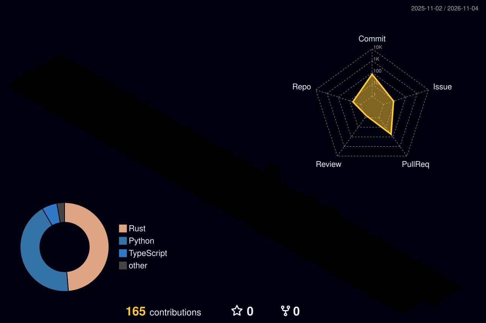

### Nice ways to reach me

----

웹 서비스 개발로 시작해 지금은 사내 개발 인프라 전체를 맡고 있는 엔지니어입니다. Spring Boot로 관리 콘솔과 관제 대시보드를 만들다가 배포 자동화를 거쳐 인프라로 넘어왔고, 지금은 서버 10대 규모 사내망의 CI/CD·메신저·VPN·DB·백업을 직접 세우고 있습니다. "될 것 같다" 대신 끊김 시간과 손실 건수를 재서 기록합니다.

회사 프로젝트는 사내 GitLab에 있어서, 기여도와 문제 → 원인 → 해결 과정은 [포트폴리오](https://qnd1101.github.io)에 정리해 두었습니다.

----
### Personal stats:

  
Highlights / Proficiencies

   

  <strong>Highlights</strong>

  - [서버 이중화](https://qnd1101.github.io/프로젝트/서버-이중화) — 외부 진입·이슈 관리 도구·VPN을 장비 구매 없이 이중화, 서버 한 대 정지 시 끊김 1~30초
  - [사내 메신저 구축과 이중화](https://qnd1101.github.io/프로젝트/사내-메신저-구축-이중화) — 메시지 28,118건 무손실 이전, 전환 2초
  - [PostgreSQL 통합 DB 클러스터](https://qnd1101.github.io/프로젝트/통합-DB-클러스터) — Patroni 기반, 주 DB 강제 종료 시 약 25초 자동 전환, 손실 0
  - [주간 백업·복원 시험 체계](https://qnd1101.github.io/프로젝트/백업-복원-체계) — 서비스 5종 격리 복원 시험 통과
  - [GitLab 원격 코드 실행 취약점 긴급 대응](https://qnd1101.github.io/프로젝트/GitLab-긴급-보안대응) — 하룻밤에 8단계 메이저 업그레이드
  - [Blue-Green 무중단 배포](https://qnd1101.github.io/프로젝트/무중단-배포) — 배포 중 요청 1,203회 전부 정상 응답
  - [CI/CD 운영과 릴리스 흐름 개편](https://qnd1101.github.io/프로젝트/CI-CD-운영) — 태그 하나로 빌드·업로드·알림까지 자동
  - [ARM64 크로스컴파일 빌드 도입](https://qnd1101.github.io/프로젝트/ARM64-크로스컴파일-빌드) — 보안정책 제약 안에서 x86 → ARM64 빌드 약 2.5분
  - [임베디드 보드 온도 실측 분석](https://qnd1101.github.io/프로젝트/보드-온도-실측-분석) — 15시간 54,001건 측정, 데이터로 방열판 장착 판단
  - [게이트 실시간 모니터링 대시보드](https://qnd1101.github.io/프로젝트/게이트-모니터링-대시보드) · [관리자 웹 콘솔](https://qnd1101.github.io/프로젝트/관리자-웹-콘솔) — Spring Boot 웹 개발, Jenkins 원클릭 배포

   

  <strong>Proficiencies</strong>

  - Backend: Java 17, Spring Boot, eGovFrame, Spring Security, Thymeleaf, MQTT, WebSocket
  - Embedded & Build: Python, Cython, Nuitka, PyInstaller, ARM64 크로스컴파일
  - OS & Hardware: Rocky Linux 9, Dell PowerEdge, iDRAC(IPMI), NanoPi(ARM64)
  - Container & HA: Docker, Podman, keepalived, Pacemaker, Patroni, etcd, systemd
  - DB & Messaging: PostgreSQL, MongoDB, MariaDB, Redis, NATS
  - Network & Security: nginx, headscale(Tailscale), nftables, firewalld, Let's Encrypt
  - CI/CD & Collaboration: Jenkins, JFrog Artifactory, GitLab, SonarQube, Rocket.Chat

### Skills

----

